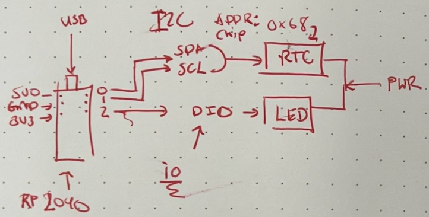

# Phase Clock

A RP2040 + PCF8523 RTC + WS2812 LED clock that shows the time of day as color bands instead of numbers.

The PCF8523 stores **UTC**, continues counting on its coin cell, and can provide a 1 Hz pulse on INT1. The RP2040 (written for an RP2040-Zero board) converts UTC to US Pacific local time (PST/PDT, with the DST rules) and sets the LED color by hour. The RTC keeps time while the board is unpowered.

## Materials

- RTC: PCF8523 RTC breakout board
- Microcontroller: Raspberry Pi RP2040-Zero
- RGB LED: WS2812 RGB LED breakout module
- CR1220 3 V lithium coin cell (RTC backup)

## Wiring



## Files

- `main.py`: firmware that runs on the board
- `pcf8523.py`: PCF8523 driver (device)
- `pacific_time.py`: UTC to Pacific conversion (device)
- `sync_from_pc.py`: sets the RTC from the computer's UTC time (computer)

## Install and synchronize

On the computer, install MicroPython on the board, then run:

```sh
python -m pip install mpremote
python -m mpremote connect auto fs cp pcf8523.py :pcf8523.py
python -m mpremote connect auto fs cp pacific_time.py :pacific_time.py
python -m mpremote connect auto fs cp main.py :main.py
python sync_from_pc.py
```

`sync_from_pc.py` sends the computer's UTC time (independent of its local timezone), sets Control_3 to direct battery switch-over, writes the time to the RTC, and resets the board so `main.py` restarts.

After initial sync, the RP2040 starts `main.py` on each reset, reading the coin-cell-backed PCF8523. Re-run `python sync_from_pc.py` (with the board connected over USB and the computer's clock correct and the coin cell in place) if the LED stays dark during a color band or to correct drift.

## Behavior

- On boot, `main.py` shows cyan for 3 seconds (`STARTUP_TEST_SECONDS`) as a hardware self-test, then turns the LED off.
- `main.py` enables the PCF8523 1 Hz second interrupt on INT1 and reads the time on each pulse. It also polls every 10 s in case a pulse is missed, so polling is authoritative.
- If a read fails while running (I2C error, oscillator-stop flag, invalid date), the LED turns off and the error is printed once. If the RTC is not detected at startup, `main.py` stops with an exception instead.
- Once per local minute, `main.py` prints the UTC time, local time, zone, scheduled color and output RGB over serial.

## Colors (local Pacific time)

- 05:00 to 05:59: lavender
- 06:00 to 06:59: cyan
- 23:00 to 23:59: lavender
- All other hours: LED off (can be modified in `color_at_hour` in `main.py`)

`BRIGHTNESS = 0.50` sets output intensity (0.0 to 1.0).
